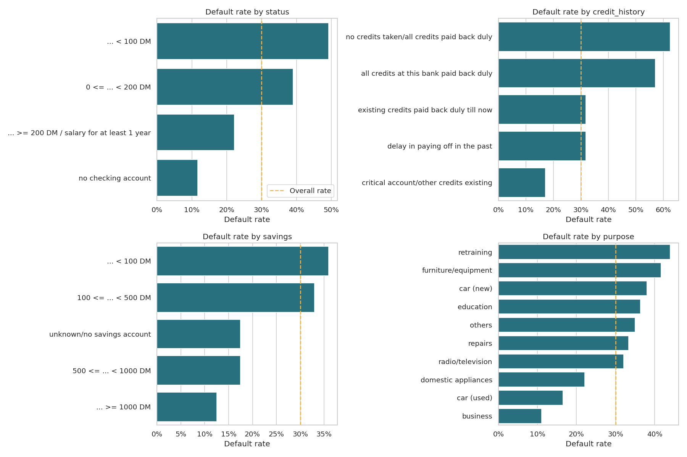
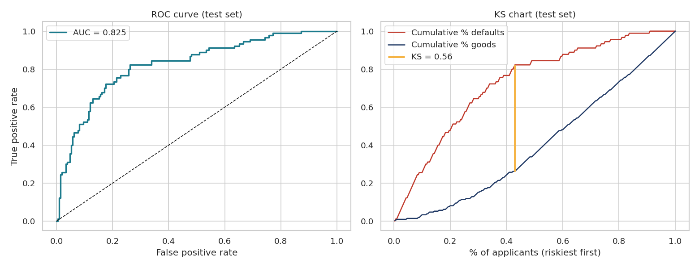

# Credit Risk Analysis & Application Scorecard

  

Built an explainable credit scorecard that predicts loan default and turns it into approve / review / reject decisions.

## Highlights
- Analysed **1,000 loan applicants** (German Credit dataset, UCI) — overall default rate 30%.
- Ranked 20 variables with **Weight of Evidence (WoE) and Information Value (IV)**; kept 15 predictive features.
- Built a **Logistic Regression scorecard** — test **AUC 0.83, Gini 0.65, KS 0.56**, no over-fitting.
- Converted model output into **scorecard points** (600 points = 50:1 odds, PDO 20) and **5 risk bands** (default rate from ~4.5% in band A to ~67% in band E).
- Cut-off analysis: a score cut-off of 490 approves ~76% of applicants and lowers the default rate of the approved book from 30% to ~18%.

## Preview





## Folder structure
```
01_Credit_Risk_Analysis/
├── credit_risk_analysis.ipynb   # full analysis, run top to bottom
├── data/german_credit.csv       # raw data
├── outputs/
│   ├── scorecard_points.csv     # points for every attribute bin
│   ├── scored_applicants.csv    # score + risk band per applicant
│   └── charts/                  # all charts used in the analysis
├── requirements.txt
└── README.md
```

## How to run
```bash
pip install -r requirements.txt
jupyter notebook credit_risk_analysis.ipynb
```

## Data source
German Credit Data — UCI Machine Learning Repository (Hofmann, 1994), cleaned version with readable labels.
