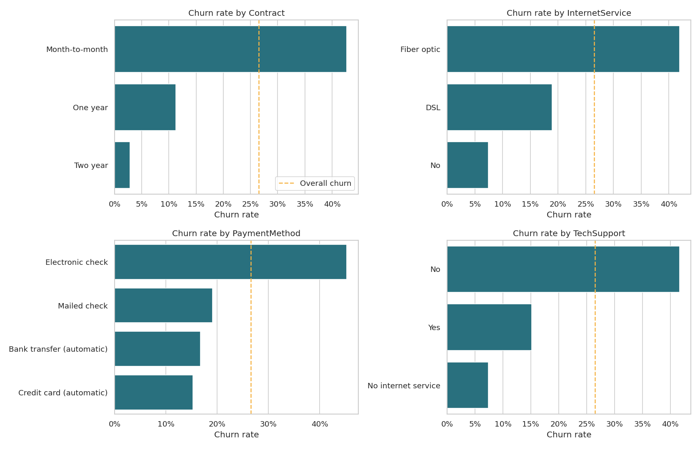
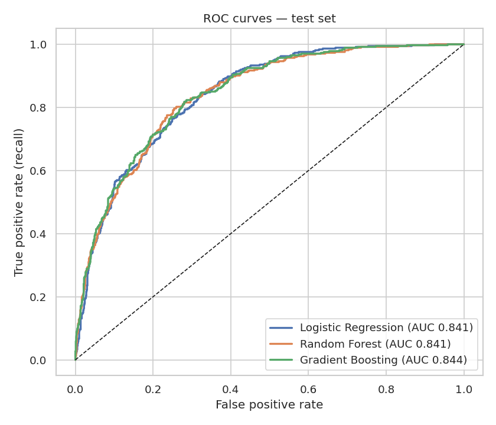

# Customer Churn Prediction — Machine Learning

  

Predicts which telecom customers are likely to leave, explains why, and produces a ranked call list for the retention team.

## Highlights
- **7,043 customers**, 19 features, 26.5% churn (imbalanced classes).
- Cleaned `TotalCharges` (blank values = new customers with 0 tenure, filled with 0).
- Scikit-learn **Pipeline** (StandardScaler + OneHotEncoder) — no data leakage, one object to save and reuse.
- Compared **Logistic Regression, Random Forest and Gradient Boosting** with 5-fold stratified cross-validation (all ≈ 0.85 ROC-AUC); selected Gradient Boosting (test **ROC-AUC 0.84**).
- **Threshold tuning** for the business goal: at 0.25 the model catches ~80% of churners.
- **Permutation importance**: contract type and tenure are the top drivers.
- **Gains chart**: contacting the riskiest 30% of customers reaches **66% of all churners** (2.2× better than random).
- Saved model + reusable `train.py` / `predict.py` scripts.

## Preview





## Folder structure
```
02_Customer_Churn_Prediction_ML/
├── churn_prediction.ipynb        # full analysis and modelling
├── data/telco_customer_churn.csv
├── src/
│   ├── train.py                  # retrain the model from the command line
│   └── predict.py                # score a CSV of customers
├── models/churn_model.joblib     # saved pipeline + chosen threshold
├── outputs/
│   ├── test_customers_scored.csv
│   ├── predictions.csv
│   └── charts/
├── requirements.txt
└── README.md
```

## How to run
```bash
pip install -r requirements.txt
jupyter notebook churn_prediction.ipynb     # full walkthrough
python src/train.py                         # retrain and save the model
python src/predict.py data/telco_customer_churn.csv   # score customers -> outputs/predictions.csv
```
(Run the scripts from the project folder.)

## Data source
IBM Telco Customer Churn sample dataset (IBM, public GitHub repository).
