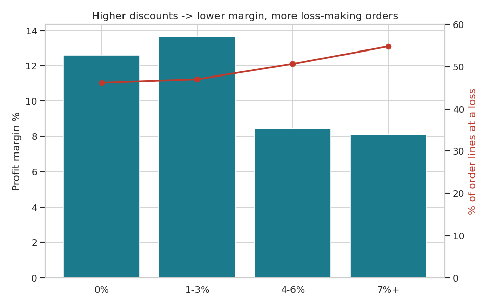
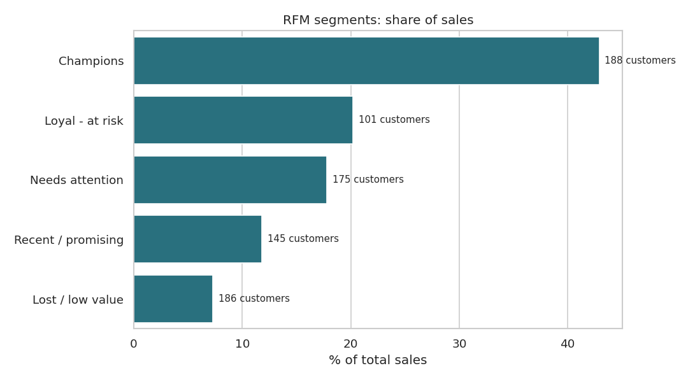

# Sales & Profitability Analysis — SQL + Python

  

End-to-end business analysis of a retailer's sales: SQL for the business questions, Python for trends, profitability, discount impact, shipping and customer segmentation.

## Highlights
- **8,399 order lines**, 795 customers, 2009–2012; ~14.9M sales, ~1.5M profit (10.2% margin).
- Data-quality checks found customers listed in multiple segments and order IDs shared by multiple customers — documented, not hidden.
- **10 SQL queries** using CTEs, window functions (LAG, RANK, ROW_NUMBER), CASE WHEN, HAVING and subqueries.
- Found that **Tables and Bookcases lose money** and Furniture earns only a 2% margin.
- Showed that discounts above 3% cut margin from ~13% to ~8% and increase loss-making orders.
- **Pareto analysis**: top 20% of customers drive 46% of sales.
- **RFM segmentation**: 101 "Loyal – at risk" customers hold 20% of sales → win-back campaign target.

## Preview






## Folder structure
```
03_Sales_Profitability_Analysis/
├── sales_profitability_analysis.ipynb   # full analysis
├── data/superstore_sales.csv
├── sql/
│   ├── load_to_sqlite.py                # builds sql/superstore.db
│   ├── analysis_queries.sql             # 10 business queries
│   └── superstore.db
├── outputs/
│   ├── rfm_customer_segments.csv
│   ├── subcategory_profitability.csv
│   ├── region_performance.csv
│   ├── monthly_sales_profit.csv         # ready for a Power BI dashboard
│   └── charts/
├── requirements.txt
└── README.md
```

## How to run
```bash
pip install -r requirements.txt
python sql/load_to_sqlite.py              # create the SQLite database
jupyter notebook sales_profitability_analysis.ipynb
```
The SQL file can also be run in DB Browser for SQLite, DBeaver or any SQL tool.

## Data source
Superstore Sales sample dataset (Tableau sample data, Canadian edition), public GitHub mirror.
