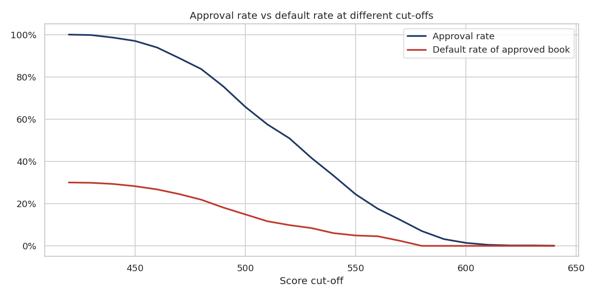
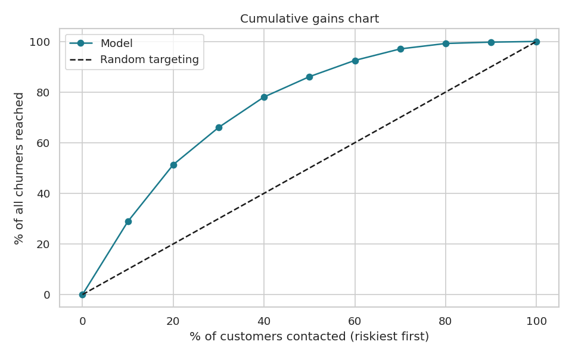
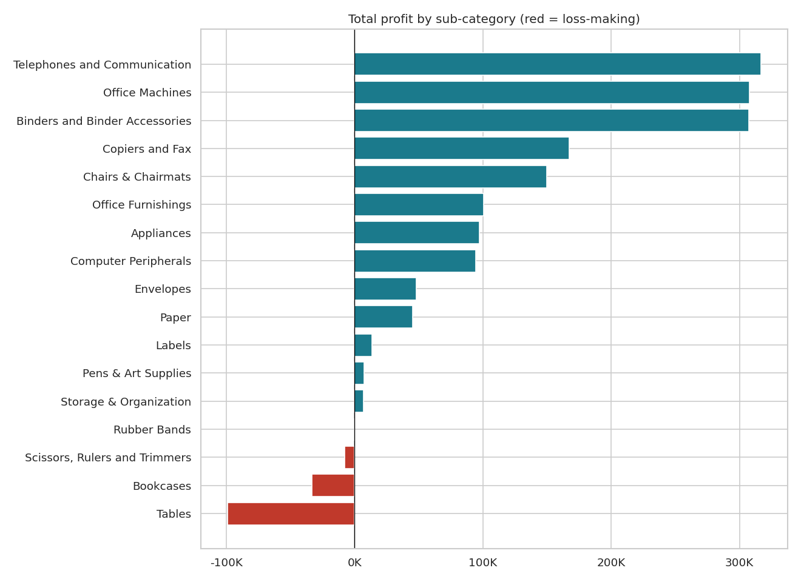

# 📊 Data Analytics Portfolio — Prathamesh Tirshu

**Data Analyst | Business Intelligence | Predictive Analytics**
4+ years in data analytics, MIS reporting and risk analytics · SQL · Python · Power BI · Tableau · Excel


Self-directed projects built on public datasets, each with clean code, documented decisions, charts and business recommendations.

---

## Projects

### 1. [Credit Risk Analysis & Application Scorecard](01_Credit_Risk_Analysis)
WoE/IV feature selection → logistic regression scorecard → risk bands and approval cut-off.
**Test AUC 0.83 · Gini 0.65 · KS 0.56** · cut-off cuts approved-book default rate from 30% to 18% while approving 76% of applicants.



### 2. [Customer Churn Prediction — Machine Learning](02_Customer_Churn_Prediction_ML)
Scikit-learn pipelines, 3-model comparison with 5-fold cross-validation, threshold tuning, permutation importance, saved model with train/predict scripts.
**ROC-AUC 0.84 · 80% of churners caught · top 30% riskiest customers = 66% of all churners**



### 3. [Sales & Profitability Analysis — SQL + Python](03_Sales_Profitability_Analysis)
10 business SQL queries (CTEs, LAG, RANK, ROW_NUMBER), profitability, discount impact, shipping, Pareto and RFM segmentation.
**Found loss-making product lines, a 5-point margin drop from discounting, and a 20%-of-sales "at-risk" customer group.**



---

## Skills demonstrated
| Area | Tools & techniques |
|---|---|
| Data analysis | Pandas, NumPy, EDA, data-quality checks, Pareto, RFM |
| SQL | Aggregations, CTEs, window functions, CASE WHEN, subqueries |
| Machine learning | Logistic Regression, Random Forest, Gradient Boosting, pipelines, cross-validation, threshold tuning |
| Risk analytics | WoE / IV, scorecard scaling (PDO), AUC / Gini / KS, cut-off strategy |
| Visualisation | Matplotlib, Seaborn |

## How to run
```bash
git clone <this-repo-url>
cd <repo-folder>/01_Credit_Risk_Analysis      # or any project folder
pip install -r requirements.txt
jupyter notebook
```

## Contact
📧 prathameshtirshu01@gmail.com · 💼 [LinkedIn](https://www.linkedin.com/in/prathamesh-tirshu-aa93581b0)
